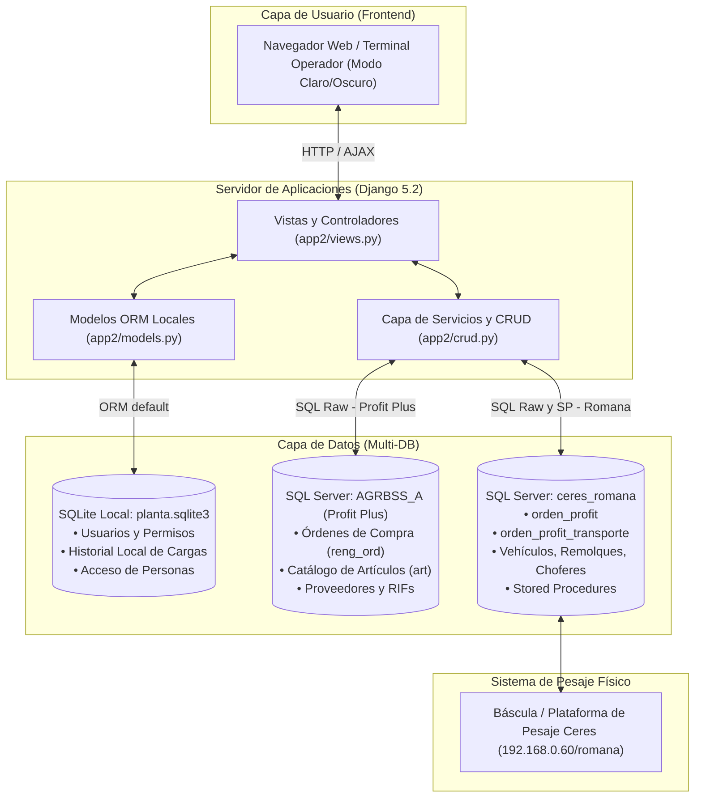
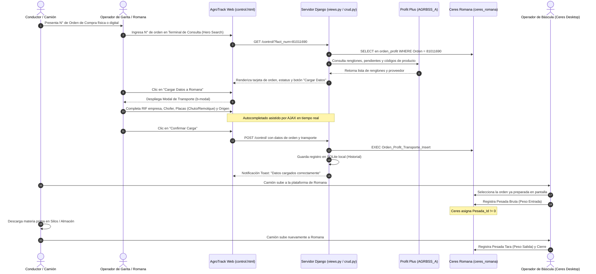
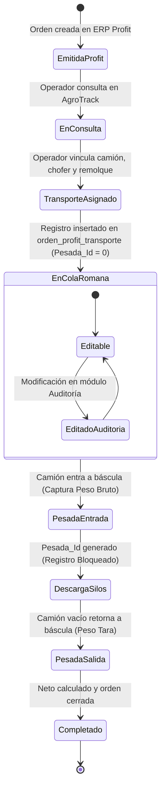

# Documentación Integral del Sistema AgroTrack - Planta Milenio

Bienvenido a la documentación técnica, arquitectónica y operativa del sistema **AgroTrack / Planta Milenio**. Este documento describe en profundidad el funcionamiento del sistema, el flujo de recepción de materia prima e ingreso de vehículos de carga pesada, la interacción con las bases de datos externas de ERP y romana, y la estructura de archivos que compone la aplicación.

---

## 1. Visión General del Sistema

**AgroTrack** es una plataforma web desarrollada en **Django 5.2** diseñada para el control operativo, seguridad y pesaje en báscula de la **Planta Milenio (AgroLucha C.A.)**.

### Objetivos Clave
1. **Control de Entradas de Materia Prima**: Recepción de camiones a granel (maíz, torta de soya, aceite, harinas, aditivos), validación contra órdenes de compra del ERP administrativo y pre-registro de transporte hacia el sistema de romana.
2. **Integración con Sistema de Romana (Ceres Romana)**: Despacho de datos de vehículos, conductores, remolques y productos para agilizar el pesaje y eliminar errores manuales en caseta de pesaje.
3. **Auditoría de Transporte Pesado**: Supervisión y corrección de datos antes del pesaje definitivo, asegurando la inmutabilidad de registros con pesadas confirmadas.
4. **Control de Acceso de Personas**: Registro de visitantes, contratistas, choferes y proveedores peatonales con tiempos de estancia y autorizaciones.
5. **Reportes Ejecutivos Oficiales**: Exportación de documentos PDF de alta resolución con indicadores clave (KPIs), gráficas vectoriales (pastel y barras) y bitácoras cronológicas para auditorías.

---

## 2. Arquitectura de Sistemas y Multi-Base de Datos

El sistema opera bajo un esquema **Multi-Database** con tres conexiones simultáneas configuradas en [settings.py](proyecto/settings.py#L65-L102):



### Bases de Datos Utilizadas

| Identificador Django | Motor | Host / Ubicación | Propósito y Contenido |
| :--- | :--- | :--- | :--- |
| `default` | SQLite 3 | `planta.sqlite3` | Base de datos interna del sistema web: usuarios (`User_admin`), accesos peatonales (`AccesoPersona`) e historial local (`Historial`). |
| `sqlserver` | MSSQL (FreeTDS) | `10.10.1.1:1433 / AGRBSS_A` | Base de datos corporativa de **Profit Plus Administrativo**: órdenes de compra (`reng_ord`), artículos (`art`) y clientes/proveedores. |
| `ceres_romana` | MSSQL (FreeTDS) | `10.10.1.1:1433 / ceres_romana` | Base de datos del **Software de Báscula Ceres**: colas de transporte (`orden_profit_transporte`), órdenes cargadas (`orden_profit`), tablas maestras de vehículos, tanques y choferes. |

---

## 3. Flujo Detallado de Ingreso de Materia Prima y Camiones

El flujo de camiones de carga pesada es el núcleo operativo de la planta. Integra la validación comercial en ERP, la preparación en garita y el pesaje físico en romana.



### Explicación Paso a Paso de las Etapas

#### Etapa 1: Llegada del Vehículo y Consulta de Orden
1. El vehículo arriba a la entrada de Planta Milenio. El conductor presenta la orden de compra.
2. El operador introduce el número de orden en el **Hero Action Box** de [control.html](app2/templates/control.html).
3. La función `views.control` ejecuta `ControlDeMateriaPrima.get_registros()`, que verifica si la orden está precargada en `ceres_romana.orden_profit`.
4. Si la orden existe, se recupera el proveedor, estatus, producto y cantidades. Se muestran tarjetas de estatus: *Sin procesar*, *Semi procesado*, *Procesado*, *Activa* o *Cerrada*.

#### Etapa 2: Formulario Modal de Carga de Transporte
Al hacer clic en **"Cargar Datos a Romana"**, se abre el modal con autocompletados conectados a Ceres:
* **Producto a recibir**: Selector de renglón con código de producto.
* **RIF Empresa de Transporte**: Autocompletado vía `/autocomplete/empresa/`.
* **Cédula del Conductor**: Autocompletado vía `/autocomplete/conductor/` (asocia nombres y apellidos).
* **Placa del Vehículo (Chuto)**: Autocompletado vía `/autocomplete/chuto/`.
* **Placa del Remolque (Tanque / Batea)**: Autocompletado vía `/autocomplete/tanque/`.
* **Origen / Procedencia**: Autocompletado vía `/autocomplete/destino/`.

#### Etapa 3: Inserción en Romana y Base Local
Al confirmar el formulario:
1. `ControlDeMateriaPrima.insert_orden_transporte()` ejecuta el stored procedure `[dbo].[Orden_Profit_Transporte_Insert]` en la base de datos `ceres_romana`.
2. Se crea un registro en el modelo `Historial` de `planta.sqlite3` para auditoría interna rápida y reportes.

#### Etapa 4: Pesaje y Bloqueo de Seguridad (Auditoría)
1. En el software de báscula de romana, el operador ya tiene disponible el viaje precargado con todos los datos correctos sin necesidad de transcribirlos.
2. **Regla de Inmutabilidad**: Mientras el camión no haya sido pesado (`Pesada_Id == None` o `0`), el registro puede ser corregido en el módulo de [control_auditoria.html](app2/templates/control_auditoria.html). En el instante en que la báscula captura la pesada (`Pesada_Id > 0`), el sistema bloquea cualquier edición para garantizar la integridad contable y legal.

---

## 4. Diagrama de Estados de una Orden de Transporte



---

## 5. Módulos del Sistema y sus Funcionalidades

### 5.1. Control de Entradas de Materia Prima ([control.html](app2/templates/control.html))
* **Hero Search Terminal**: Input amplio con autofocus, búsqueda por <kbd>Enter</kbd> y botón de consulta directa.
* **KPIs Rápidos**: Órdenes en consulta, total de cargas en historial y estado en línea de la romana.
* **Historial Paginado**: Tabla de auditoría cronológica con badges de estado y diseño adaptativo a modo claro/oscuro.

### 5.2. Control de Acceso de Personas ([control_personas.html](app2/templates/control_personas.html))
* **Registro de Ingreso**: Formulario con nombre, apellido, cédula, empresa, motivo, placa vehicular, persona visitada y autorizador.
* **Autocompletado Inteligente**: Recuerda nombres, cédulas y empresas de visitantes habituales.
* **Control de Salida**: Botón de un solo clic *"Salida"* que sella la `hora_salida` y calcula la duración exacta de permanencia en minutos.

### 5.3. Auditoría de Transportes ([control_auditoria.html](app2/templates/control_auditoria.html))
* **Supervisión de Romana**: Lista de registros en tabla `orden_profit_transporte`.
* **Edición Controlada**: Ejecuta `ControlAuditoria.actualizar_registro()` invocando el Stored Procedure `[dbo].[Orden_Profit_Transporte_Update]` sólo si `Pesada_Id` no ha sido emitido.

### 5.4. Centro de Reportes PDF ([reportes.html](app2/templates/reportes.html))
* **Filtros Rápidos**: Botones para autocompletar fechas: *"Hoy"*, *"Últimos 7 días"*, *"Este mes"*.
* **Generación WeasyPrint**: Motor que convierte plantillas HTML/CSS en documentos PDF horizontales A4.
* **Portadas con Gráficas Estadísticas Vectoriales**:
  * **Donut Chart SVG**: Top materias primas más ingresadas con porcentaje exacto.
  * **Bar Chart SVG**: Flujo y frecuencia de camiones por día de la semana.
  * **Bitácora Detallada y Firmas**: Tablas con firmas de garita, seguridad y auditoría.

### 5.5. Gestión de Usuarios y Permisos ([control_usuarios.html](app2/templates/control_usuarios.html))
* **Seguridad Criptográfica**: Passwords con hash seguro PBKDF2 (`make_password`).
* **Permisos Granulares por Módulo**:
  * `permiso_control`: Acceso a entradas de materia prima.
  * `permiso_control_personas`: Acceso a registro de visitantes.
  * `permiso_auditoria`: Acceso a modificar transportes en romana.
  * `permiso_reportes`: Descarga de reportes PDF.
  * `permiso_usuarios`: Crear, editar o eliminar usuarios del sistema.
  * `solo_consulta`: Bloquea acciones de escritura (`POST`), permitiendo sólo visualizar y descargar.

---

## 6. Estructura de Archivos y Descripción de Componentes

A continuación se detalla la estructura física de directorios del proyecto y el rol de cada archivo:

```
Planta_Milenio/
├── manage.py                     # CLI de administración de Django
├── CreateUser.py                 # Script de consola/interfaz para crear usuarios administradores
├── requirements.txt              # Dependencias de Python del proyecto
├── INSTALACION.txt               # Guía básica de despliegue en servidor
├── planta.sqlite3                # Base de datos SQLite local (default)
├── db.sqlite3                    # Base de datos SQLite secundaria / legacy
│
├── proyecto/                     # Módulo de configuración principal
│   ├── settings.py               # Configuración global, Multi-DB, static, sesiones
│   ├── urls.py                   # Enrutador principal (redirecciona a app2.urls)
│   ├── wsgi.py                   # Punto de entrada para servidores WSGI (Gunicorn)
│   └── asgi.py                   # Punto de entrada ASGI
│
├── app2/                         # Aplicación principal del sistema
│   ├── models.py                 # Modelos ORM: User_admin, Historial, AccesoPersona
│   ├── views.py                  # Vistas de autenticación, materias primas, personas, reportes
│   ├── urls.py                   # Definición de rutas, endpoints y autocompletados
│   ├── crud.py                   # Lógica de conexión SQL Server (Profit y Romana) y SPs
│   ├── admin.py                  # Configuración para el panel de administración
│   │
│   └── templates/                # Plantillas HTML del sistema
│       ├── base.html             # Layout maestro (Sidebar Bankio, Topbar, Reloj, Dark Mode)
│       ├── login.html            # Pantalla de inicio de sesión estilizada con tema dual
│       ├── control.html          # Vista operativa de consulta y carga de materia prima
│       ├── control_personas.html # Vista de registro y bitácora de visitantes
│       ├── control_auditoria.html# Vista de supervisión y edición de romana
│       ├── control_usuarios.html # Panel administrativo de usuarios y matriz de permisos
│       ├── reportes.html         # Panel de descarga y filtros de fechas para PDFs
│       ├── pdf_materia_prima.html# Plantilla PDF de Materia Prima con gráficos SVG y firmas
│       └── pdf_personal.html     # Plantilla PDF de Personas con gráficos SVG y firmas
│
├── app1/                         # Módulo complementario / legacy
│   ├── models.py                 # Definición unmanaged de 'OrdenDetalle' (reng_ord)
│   ├── views.py                  # Vistas auxiliares (index)
│   └── urls.py                   # Rutas de app1
│
└── assets/                       # Recursos estáticos servidos en desarrollo y producción
    ├── css/
    │   ├── bankio-theme.css      # Sistema de diseño moderno (Modo Claro/Oscuro, Bankio)
    │   ├── main.css              # Estilos base legacy
    │   ├── login-styles.css      # Estilos previos de login
    │   └── paneles-style.css     # Estilos de paneles anteriores
    ├── images/
    │   ├── Agrotrack_logo.png    # Logo principal del sistema AgroTrack
    │   └── logo.png              # Logo secundario
    └── js/
        ├── main.js               # Scripts auxiliares de navegación móvil
        └── compras.js            # Script para módulos de compras
```

### Tabla Resumen de Archivos Clave

| Archivo | Rol Principal |
| :--- | :--- |
| [proyecto/settings.py](proyecto/settings.py) | Define las conexiones a bases de datos (`default`, `sqlserver`, `ceres_romana`), directorios de estáticos (`assets`), middleware de autenticación y zona horaria `America/Caracas`. |
| [app2/models.py](app2/models.py) | Define las entidades locales: `User_admin` (usuarios y permisos por bandera booleana), `Historial` (registro de cargas procesadas) y `AccesoPersona` (bitácora de entradas y salidas de visitantes). |
| [app2/crud.py](app2/crud.py) | Contiene las clases `ControlDeMateriaPrima`, `ControlAuditoria` y `ControlUsuarios`. Ejecuta sentencias SQL crudas sobre Profit Plus y ejecuta los Stored Procedures `Orden_Profit_Transporte_Insert` y `Orden_Profit_Transporte_Update` sobre Ceres Romana. |
| [app2/views.py](app2/views.py) | Orquestador principal de peticiones HTTP: inicio/cierre de sesión, consulta de órdenes de compra, cálculo estadístico para reportes (`compute_materia_prima_stats`), renderizado WeasyPrint a PDF y endpoints AJAX de autocompletado. |
| [app2/templates/base.html](app2/templates/base.html) | Plantilla base responsiva con motor de temas Claro/Oscuro (*zero-flicker* en `localStorage`), sidebar flotante, reloj digital oficial de Venezuela y sistema de notificaciones toast. |
| [assets/css/bankio-theme.css](assets/css/bankio-theme.css) | Sistema de diseño completo: variables CSS de paleta *Bankio Dark Teal*, Hero Search Box, componentes de tablas de alto contraste, tarjetas métricas y modo oscuro profundo. |
| [CreateUser.py](CreateUser.py) | Utilidad de línea de comandos para inicializar cuentas de administración directamente sobre el ORM sin necesidad de levantar el servidor web. |

---

## 7. Buenas Prácticas y Recomendaciones para Servidor de Producción

1. **Gestión de Base de Datos en Git**:
   * Los archivos `planta.sqlite3` y `db.sqlite3` ya han sido retirados del índice de Git (`git rm --cached`) e ignorados en [.gitignore](.gitignore).
   * Al hacer `git pull` en el servidor de producción, la base de datos de producción nunca será sobreescrita ni causará conflictos de fusión (*merge conflicts*).
2. **Archivos Estáticos en Producción**:
   * Ejecutar siempre `python manage.py collectstatic --noinput` tras actualizar estilos o imágenes para asegurar que Nginx o Gunicorn sirvan las versiones compiladas.
3. **Conectividad FreeTDS / SQL Server**:
   * Asegurarse de que el servidor Linux tenga instalado el paquete `freetds-bin` y `unixodbc` para garantizar la conexión remota con el servidor MSSQL `10.10.1.1:1433`.
4. **Respaldos de Datos**:
   * Programar un cron diario para respaldar el archivo SQLite local `planta.sqlite3` en un almacenamiento externo.

---

## 8. Guía de Actualización y Despliegue en el Servidor (Ubuntu Linux)

Para actualizar el sistema en el servidor de producción (**Ubuntu**) tras realizar cambios en el repositorio, sigue estos pasos desde la terminal en el directorio raíz del proyecto:

### Paso 1: Descargar los cambios desde Git
Como las bases de datos `.sqlite3` ya no están rastreadas en Git, el pull se ejecutará limpiamente sin riesgo de sobrescribir los datos reales del servidor:
```bash
git pull origin master
```

### Paso 2: Activar el entorno virtual
El entorno virtual está ubicado en la raíz del proyecto y se llama `venv`:
```bash
source venv/bin/activate
```

### Paso 3: Ejecutar migraciones de la base de datos (por si acaso)
Aplica cualquier migración pendiente de los modelos de datos:
```bash
python manage.py migrate
```

### Paso 4: Recopilar archivos estáticos
Si se actualizaron hojas de estilo CSS (tema Bankio), scripts JS o logos:
```bash
python manage.py collectstatic --noinput
```

### Paso 5: Reiniciar el servicio web
Para que el servidor de aplicaciones (Gunicorn) cargue el código actualizado:
```bash
sudo systemctl restart gunicorn
```
*(O según el gestor en tu servidor: `sudo supervisorctl restart all` o `sudo systemctl restart nginx`).*

---

> [!TIP]
> **Comando rápido de actualización (todo en una sola línea):**
> ```bash
> git pull origin master && source venv/bin/activate && python manage.py migrate && python manage.py collectstatic --noinput && sudo systemctl restart gunicorn
> ```
